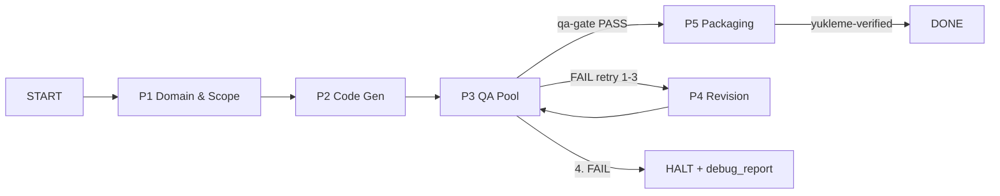

# App-Fabrika Web Edition

**Freelance web projesi üretim fabrikası:** deterministik state graph, 5 ajanlı
denetim, IDE-agnostik kontratlar ve 14 kontrollü QA gate ile PHP/MySQL projelerini
**kalite garantili** üretir — hız vaadi değil, **her projenin aynı kapılardan
geçmesini** garantiler.

Eksik CRUD, unutulan RBAC, kırık bağımlılık ve kayıp denetim izi problemlerini
çözer: domain analizi → kod → QA → paketleme. Üç IDE (Cursor / OpenCode /
Claude Code) aynı `.factory/` state'ini okur/yazar.

[](https://github.com/UlasKasikci/repo/actions/workflows/validate.yml)
[](LICENSE)
[](scripts/web/self-test.sh)

---

## Problem ve Çözüm

| Problem | Çözüm |
|---------|-------|
| Her projeye sıfırdan başlama | `bootstrap-project.sh` + iskelet kopyalama |
| Eksik CRUD / unutulan RBAC / kayıp KVKK | P1 proaktif domain denetimi (module_matrix kapısı) |
| Kırık bağımlılık, sessiz hata | QA gate: 14 kontrol, 0 Error / 0 Warning zorunlu |
| Denetimsiz kod üretimi (kalite belirsizliği) | Her faz artefakt kapılı; PASS'siz faz geçişi yok |
| IDE kilitlenmesi | IDE-agnostik kontratlar (`.factory/contracts`) |

---

## Mimari Genel Bakış

### State Graph



```text
START → P1 → P2 → P3 ──PASS──→ P5 → DONE
                 │
                 ├─FAIL (retry 1-3)→ P4 → P3
                 └─4. FAIL → HALT + debug_report.json
```

- Kapı artefaktları: P1 `domain-report.json` (şema doğrulanır) · P3 `qa-gate.sh`
  exit 0 · P5 `packaging-report.json` result=PASS.
- `max_retries: 3` — 4. başarısızlık HALT; sonsuz döngü yok.
- `additionalProperties: true` şemalar korunur (opsiyonel alan ekleme serbest).

### Ajanlar (5)

| # | Ajan | Dosya | Faz | Sorumluluk |
|---|------|-------|-----|-----------|
| 1 | Requirement & Domain Architect | `.cursor/agents/web-domain-architect.md` | P1 | İstek ayrıştırma; eksik modül (RBAC, sepet, KVKK) proaktif enjeksiyonu |
| 2 | Core Web & Database Engineer | `.cursor/agents/web-core-engineer.md` | P2, P4 | PHP 8.1+ MVC çekirdek, PDO şema, normalize SQL |
| 3 | UI/UX & Frontend Specialist | `.cursor/agents/web-frontend-specialist.md` | P2 | Semantik HTML5, erişilebilir, SEO dostu arayüz |
| 4 | QA & Security Gatekeeper | `.cursor/agents/web-qa-gatekeeper.md` | P3 | `qa-gate.sh` işletir; PASS vermeden faz geçişi yok (`readonly`) |
| 5 | Production Deployment & Packager | `.cursor/agents/web-deploy-packager.md` | P5 | Build isolation + `Yukleme/` üretimi |

Tek ajan onayı yasaktır: P1→P2 yalnız domain raporuyla, P3→P5 yalnız QA PASS'ıyla.

### Katmanlar

```text
┌─ Kontratlar ── .factory/contracts/*.schema.json (P1/P3/P5 artefakt doğrulama)
├─ Ajanlar ───── .cursor/agents/ + .opencode/agent/ + .cursorrules + CLAUDE.md
├─ QA Gate ───── scripts/web/qa-gate.sh (14 kontrol, 0 Error 0 Warning)
└─ Paketleme ─── scripts/web/package-yukleme.sh (staging → smoke → arşiv → takas)
```

---

## Dosya Yapısı

```text
app-fabrika/
├── .cursor/                  # Cursor IDE config
│   ├── rules/                # Proje kuralları
│   └── agents/               # 5 ajan tanımı
├── .opencode/                # OpenCode CLI config
│   ├── agent/                # 5 ajan tanımı (paralel)
│   ├── skills/               # Modül iskeletleri (kvkk-compliance, admin-crud, auth-rbac)
│   └── command/              # Slash komutlar (/web-baslat, /web-denetle, ...)
├── .factory/                 # Runtime state (proje-başına)
│   ├── contracts/            # p1/p3/p5 JSON şemaları
│   ├── web-state-graph.json  # State graph kontratı
│   ├── web-state.example.json
│   ├── model-pricing.json    # Model rate kartları
│   ├── e2e-runs/             # E2E koşu arşivi (yerel, commit dışı — bulgular docs/findings/)
│   └── metrics.jsonl         # Token/latency/model_used (proje-başına)
├── scripts/web/              # Orkestrasyon
│   ├── orchestrate.sh        # Faz sürücüsü (--auto / --strict)
│   ├── state.sh              # State geçişleri (start/advance/qa-pass/qa-fail)
│   ├── qa-gate.sh            # 14 kontrol
│   ├── frontmatter-check.sh  # Frontmatter kontratı (qa-gate 14. kontrol)
│   ├── package-yukleme.sh    # Paketleme (staging → smoke → arşiv → takas)
│   ├── smoke-test.sh         # php -S + curl canlı doğrulama
│   ├── sql-dump.sh           # Deterministik SQL dump (drift'e karşı)
│   ├── bootstrap-project.sh  # Yeni proje başlatma
│   ├── e2e-driver.sh         # E2E driver + idle watchdog (L3)
│   ├── lighthouse-verify.sh  # Lighthouse (raporlayıcı, opsiyonel)
│   └── self-test.sh          # 66 senaryo
├── docs/                     # Kanonik dokümanlar
│   ├── WEB-EDITION.md        # Teknik spesifikasyon
│   ├── MASTER-PROMPT-V2.md   # Stratejik karar + K1-K8
│   ├── FAZ2-PLAN.md          # Token ekonomisi planı
│   ├── audits/               # CONTRACT-AUDIT + REVIEW-NOTES (K8)
│   ├── protocols/            # E2E protokol notları + rapor taslakları
│   └── findings/             # E2E kalıcı bulgular (run dir commit dışı)
├── tests/                    # Fabrika testleri
├── CLAUDE.md                 # Claude Code CLI direktifleri
├── .cursorrules              # Cursor kuralları
├── antigravity.yaml          # Antigravity/Freebuff config
└── opencode.json             # OpenCode config
```

---

## Hızlı Başlangıç

### Gereksinimler

- `bash` · `php` 8.1+ (CLI) · `python3` · `git` · `shasum`
- Opsiyonel: `node`/`npm` (eslint, minify, lighthouse), `composer global`
  (`phpstan/phpunit/phpunit` — qa-gate için zorunlu)

### Kurulum

```bash
git clone https://github.com/UlasKasikci/repo.git && cd repo

# phpstan + phpunit (qa-gate'in asimetrik çekirdeği)
composer global require phpstan/phpstan phpunit/phpunit

# fabrika kendini sınamalı
bash scripts/web/self-test.sh          # hedef: 66/66 PASS
```

### Yeni proje

Tek komut (iki IDE — Cursor `/kur`, opencode `/kur`): kontrat okur, bootstrap eder,
state'i P1'e alır, QA doğrular, özet sunar. IDE yoksa terminal eşdeğeri:

```bash
# dry-run (default) — ne kopyalanacağını gösterir
bash scripts/web/bootstrap-project.sh ../my-project

# uygula
bash scripts/web/bootstrap-project.sh ../my-project --yes

# sonra: state start + qa-gate (veya IDE'de /kur + /web-baslat)
```

Bootstrap ~1.3M (Tur 2-11: denylist `.opencode/{node_modules,sessions,storage,logs,cache}`
+ `.cursor/{snapshots,history,cache}` + `.factory/{e2e-runs,test-runs}` — 7.9G runtime
bloat'ı kopyalanmaz).

### Üretim hattı

```bash
cd ../my-project

bash scripts/web/state.sh start          # P1, retry=0 (mevcut state'te: --reset, yedek alır)
bash scripts/web/orchestrate.sh . --auto # P1 → P2 → P3 sürüşü (artifact kapıları)
bash scripts/web/qa-gate.sh .            # 0 Error, 0 Warning olmadan P5 yok
bash scripts/web/package-yukleme.sh .    # Yukleme/ (yalnız QA PASS sonrası)
bash scripts/web/state.sh status         # aktif faz
```

Çıkış kodları: `0` OK · `1` FAIL · `2` HALT · `3` orkestratör bekleme (LLM adımı).

### Test projesi temizliği

Saha testleri için bootstrapped izole dizinler `../test-project-<ts>/` altında
yaşar. Silmeden önce raporlar `.factory/test-runs/<ts>/` altına kopyalanır
(zaten oradadır):

```bash
# onay isteyerek (default)
bash scripts/web/test-project-clean.sh ../test-project-20261010T155312Z

# onaysız
bash scripts/web/test-project-clean.sh ../test-project-20261010T155312Z --yes
```

Güvenlik: `.factory/web-state.json` olmayan dizin, ana repo içi dizin ve
kök/home silinemez (RED, exit 1). Log: `.factory/test-runs/cleanup.log`.

### Ortam Değişkenleri

| Değişken | Varsayılan | Ne işe yarar |
|----------|-----------|--------------|
| `MODEL_P1` / `MODEL_P2` / `MODEL_P4` | hardcoded map | Faz bazlı model routing (`provider/model`) |
| `STRICT_TOTAL_TOKENS` | 8.000.000 | `--strict` toplam bütçe eşiği (2× → exit 1) |
| `STRICT_PHASE_TOKENS` | 6.000.000 | P2-P4 tek faz eşiği |
| `STRICT_WALL_MS` | 10.800.000 | Duvar saati bütçesi (3 saat) |
| `SMOKE_PORT` / `SMOKE_PATHS` | 18000+ | Smoke test portu / ek rotalar |
| `QA_GATE_EXTRA` | (boş) | orchestrate/package qa-gate çağrısına ek bayrak (ör. `--allow-no-cart`); boşsa davranış değişmez |
| `LIGHTHOUSE_URL` | — | Tanımlı değilse Lighthouse SKIPPED |
| `E2E_TIMEOUT_SEC` / `E2E_MAX_TOKENS` | 10.800 / 15M | E2E driver dış watchdog bütçesi |
| `P2_HUMAN_ASSIST` | `false` | `true` → P2 hybrid mod (aşağıda) |

### P2 Hybrid Mod — model uyumsuzluğunda manuel üretim

P2 kod üretimi model uyumsuzluğunda (Tur 2-9/2-10: glm-5.3 0/10 write) kullanılır:
otomatik LLM kapalı, iskeleti insan yazar, P3-P5 otomatik devam eder.

```bash
P2_HUMAN_ASSIST=true bash orchestrate.sh --auto   # → "manuel P2 gerekli" + exit 3
# (iskeleti elle yaz)
bash state.sh advance .                            # P2 → P3
bash orchestrate.sh . --auto                       # P3-P5 otomatik
```

Claude 5.5 çıktığında: `MODEL_P2=claude-sonnet-5.5` tek pilotu — PASS ise hybrid
devre dışı (tam otomatik), FAIL ise hybrid kalıcı.

---

## Kullanım — Üç IDE

| IDE | Config | Kullanım |
|-----|--------|----------|
| Cursor | `.cursor/` + `.cursorrules` | Klasörü aç; 5 ajan + kurallar otomatik yüklenir |
| OpenCode | `.opencode/` + `opencode.json` | `opencode run --agent web-core-engineer` · `/web-baslat` |
| Claude Code | `CLAUDE.md` | `claude` CLI repoyu açınca direktifleri otomatik okur |

- Her IDE aynı `.factory/` state'ini okur/yazar; IDE değişimi state kaybı yaratmaz.
- Komut eşlemesi (`docs/WEB-EDITION.md` §10): `/web-baslat` · `/web-denetle` ·
  `/web-yukle` · `/web-faz`.
- ⚠ exFAT/FAT32 hacimlerde `find . -name '._*' -delete` — AppleDouble ikizleri
  komut/ajan listesini bozar.

---

## QA Gate — 14 Kontrol

`bash scripts/web/qa-gate.sh <proje>` → **0 Error, 0 Warning** zorunlu.

| # | Kontrol | Ne yapar | FAIL koşulu |
|---|---------|----------|-------------|
| 1 | `php_lint` | Tüm `.php` dosyalarına `php -l` | Sözdizimi hatası |
| 2 | `structure` | MVC yapısı (`core/`, `views/`, `index.php`) | Dosya eksik |
| 3 | `sql_schema` | FK + index + seed + RBAC + sepet | Eksik CONSTRAINT/INSERT |
| 4 | `security_grep` | OWASP grep: eval, `mysql_*`, ham md5, superglobal-in-query | Eşleşme |
| 5 | `security_policy` | CSRF'siz POST, ham çıktı basımı | Eşleşme |
| 6 | `password_policy` | `PASSWORD_ARGON2ID` / `BCRYPT` cost ≥ 12 | Zayıf hash |
| 7 | `phpstan` | Level 8 statik analiz (zorunlu çekirdek) | Yapılandırma/araç yoksa |
| 8 | `phpunit` | Birim testleri (zorunlu çekirdek) | Yapılandırma/araç yoksa |
| 9 | `eslint` | JS lint | Yapılandırma yoksa SKIPPED (tek tolerans) |
| 10 | `sql_dump` | Üretilen dump = commit'li dump (byte) | Drift |
| 11 | `kvkk` | intent=kvkk\|gdpr → legal view + consent + 2 tablo | Eksik (none → SKIPPED) |
| 12 | `domain_report` | P1 artefaktı: module_matrix ≥4, dolu evidence/justification | Şablon/uydurma kanıt |
| 13 | `static_coverage` | `phpstan ∧ phpunit` | Aksi her koşulda FAIL |
| 14 | `frontmatter` | Fabrika agent/rule/skill frontmatter kontratı (`mode`/`permission`/`globs`/K1-K8 ref) | Ref üstte, dead rule, eksik alan (K6 istisnası — somut regresyon) |

Çıktılar: `qa-report.json` (her koşuda) · `debug_report.json` (yalnız FAIL).

---

## Paketleme — `Yukleme/` Çıktısı

```text
staging (.factory/yukleme-staging)
   → smoke-test.sh (php -l + php -S + curl; FAIL → paket reddedilir)
   → mevcut Yukleme/ arşive taşınır (.factory/yukleme-archive/<ts>-<hash>/)
   → staging atomik takasla Yukleme/ olur
   → packaging-report.json (sha256 manifest)
```

```text
Yukleme/
├── assets/{css,js,images}/
├── core/  ├── views/
├── SQL/veritabani.sql          # CREATE TABLE + FK + seed, UTF-8
├── .htaccess  ├── index.php
├── robots.txt ├── sitemap.xml
```

- **Girmez:** `node_modules/`, `.git/`, `.env` (`.env.example` serbest), testler,
  `.scss`/`.ts` kaynakları, `.factory/`, raporlar.
- `MANIFEST.json` yalnız arşiv/failed içine yazılır; final paket ağacı sabittir.

---

## Yol Haritası

### v1 — Starter Kit + İlk Saha (Şimdi — **v1.0 FINAL**)

- Bootstrap + üç IDE config + QA gate (14) + paketleme + self-test (66)
- **Tamamlandı:** A1 okuma yasağı + QUESTIONS kapısı + A2 spike→write + A2' duvar-saati
  + L3 watchdog (idle+stream+CPU+no-write-cap+cpu_time_pid) + frontmatter kontratı
  + manifest-onaylı whitelist + K1a-fix plugin (`nim-stall-retry`, bun:sqlite DB polling)
  + tek-turn iskelet promptu (A.2) + `/kur` komutu (iki IDE) + CJK-check CI
  + F1-F11 (bootstrap denylist / manifest-safe add / scaffold_ok / template kopya /
  docs / traceability / kvkk-regex / P3-P5 / F9 kill_tree / F10 kapsam / F11 kur ipucu)
  + Tur 2-16 güvenlik kapıları (per-file CSRF / session / bootstrap bütünlüğü /
  advance kapısı / `--reset` kurtarma) + **ilk gerçek proje envanter-app PASS**
- **Bilinen kısıt (Tur 2-9/2-10/2-13):** P2 kod üretimi **0/10 write** (glm-5.3 0/7,
  kimi-k3 halüsinasyon). Prompt katmanı sonucu değiştirmedi — duvar model/sağlayıcı
  tarafında. **Hybrid mod** (`P2_HUMAN_ASSIST=true`) envanter-app'ta uçtan uca
  sahada doğrulandı (exit 3 → manel iskelet → P3/P5 → DONE).
- **v1.0 kararı:** P2 auto-write beklenmeden, **kalite garantili üretim** vaadiyle
  final etiketlendi; P2 *auto* v2/JEV döneminde tekrar denenecek.

### v1.x — Düzeltme yığını (öncelik sıralı)

1. P1 prompt: doğrulayıcı okuma turu sınırı (envanter-app attempt-1 fail'i:
   256k cache_read harcayıp JSON yazamadan rc=1 → resume).
2. `QA_GATE_EXTRA` yerine orchestrate'ın domain-report `approvals.cart` alanından
   `--allow-no-cart`'ı otomatik okuması.
3. `acceptance_criteria` → test eşlemesi enforce'i (traceability).
4. DB'li entegrasyon testi altyapısı (envanter-app stock domaini şimdilik DB'siz
   doğrulama yollarıyla test ediliyor).

### v2 — Optimize (2-3 ay)

- JEV model routing + bağlam pruning → P2 auto-write denemesi (glm-5.3 duvarı yeniden)
- Modül kütüphanesi (`.factory/modules/`): KVKK, admin-CRUD, auth-RBAC
  → LLM çağırmadan kopyalama
- Kapı: JEV on/off E2E karşılaştırması ≥%20 · modül kısımlarında ≥%80 ·
  5+ E2E dağılımı ile per-model `--strict` eşikler

### v3 — Kalibre (6-12 ay)

- Tüm modüller şablonlaşmış; <1M token ütopyası ama istikamet
- Çoklu dil/framework desteği (opsiyonel)

---

## Release

| Sürüm | Durum | Not |
|-------|-------|-----|
| v1.0-rc1 | Release Candidate (2026-10-09) | Starter Kit |
| v1.0-rc2 | Release Candidate (2026-10-10) | /kur + tek-turn prompt + K1a-fix plugin + hybrid mod + CJK CI |
| **v1.0-rc3** | **Release Candidate** (2026-10-11) | Hybrid iş akışı uçtan uca saha PASS (Tur 2-13) — F1-F11 fix + F3/F4/F10 doğrulandı |
| **v1.0-rc4** | **Release Candidate** (2026-10-11) | Tur 2-14 son fix turu: B-1 kvkk regex `IF NOT EXISTS` + B-2 hybrid'de P2 LLM çağrısı 0 (o tarihte self-test 49/49) |
| v1.0-rc5 | Release Candidate (2026-10-11) | Tur 2-16 güvenlik/bütünlük kapıları (A-F) — self-test 63/63 |
| **v1.0** | **Final (2026-10-11)** | **İlk gerçek proje PASS: envanter-app** — kalite garantili üretim |
| **v1.1** | **Final (2026-10-11)** | **Hız kanıtı: randevu-app, 27 dk** — pattern reuse ile rutinleşme (P2 235→12 dk) |
| **v1.2** | **Final (2026-10-12)** | **Güvenlik fix: CSRF OOP desen + /register açığı kapatıldı** — CONTRACTS sandbox + P2 prompt guard; self-test 66/66; helpdesk-app 34 dk (3/3 proje PASS) |
| v2 | Planlı | JEV routing + modül kütüphanesi |
| v3 | Vizyon | Şablonlaşma |

rc2, Tur 2-9/2-10 P2 pilotundan **bağımsız**dır: kod tabanı CI yeşil + self-test
43/43 (o tarihte) ile donduruldu; P2 model sorunu hybrid mod ile workaround edildi.
rc3, **hybrid akışın** (P1 → `P2_HUMAN_ASSIST` → manel iskelet → P3 → P5 → DONE)
Tur 2-13 e-ticaret projesinde 27 dk'da uçtan uca PASS'ı ile etiketlendi.
**v1.0**, envanter-app gerçek projesinin PASS/DONE'ı ile etiketlendi (aşağıda).
**v1.1**, ikinci gerçek proje (randevu-app) ile hız kanıtı: aynı operator +
aynı fabrika, ikinci benzer domain — toplam **27 dk** (v1.0: 4s48dk).

## Production Readiness

### v1.0 Başarı Eşikleri (ilk gerçek proje ile kalibre)

| Eşik | Hedef | envanter-app (2026-10-11) | Durum |
|------|-------|---------------------------|-------|
| Toplam süre (T0→DONE) | < 5 saat | 4s 48dk | ✓ |
| Yeni token (cache_read hariç) | < 250k | 165k | ✓ |
| Manuel müdahale (P2 hariç) | ≤ 3 | 2 | ✓ |
| QA gate | 0 Error / 0 Warning (14 kanal) | PASS (2. turda) | ✓ |

### Gerçek proje kanıtı — envanter-app (v1.0) + randevu-app (v1.1)

| Proje | Domain | Süre | Yeni token | Müdahale | Sonuç |
|-------|--------|------|------------|----------|-------|
| **envanter-app** (v1.0) | Mini envanter takip (8 tablo, stok hareketleri) | **4s 48dk** | 165k | 2 | PASS/DONE — **kalite garantisi** |
| **randevu-app** (v1.1) | Klinik/kuaför randevu (7 tablo, çakışma kurallı) | **27 dk** | 109k | 1 | PASS/DONE — **hız kanıtı** |

**v1.0 — envanter-app:** P1 PASS (2 deneme) → P2 hybrid manel iskelet (235 dk;
9 controller, 14 view, 12 unit test, phpstan L8 + phpunit 12/12) → P3 QA PASS
(Tur 2-16 per-file `verifyCsrf(` kapısı ilk sahada 7 hata yakaladı, 1 turda 0/0) →
P5 `Yukleme/` + smoke PASS → **DONE**. Ayrıntı: proje kökünde `RUN-REPORT.md`.

**v1.1 — randevu-app:** P1 PASS (1 deneme, 14 dk; attempt-1 fail'i tekrarlanmadı) →
P2 hybrid manel (**12 dk** — envanter-app pattern'lerinden doğrudan adaptasyon,
**19× rutinleşme**) → P3 tek tur (qa-gate `csrf_verify(` desen düzeltmesi) →
P5 PASS. Ayrıntı: randevu-app/RUN-REPORT.md.

**Dürüst not:** 27 dk, **benzer domain** (CRUD+auth+RBAC) ve **pattern reuse**
ile ölçüldü — operator ilk projede yazdığı iskeleti adapte etti. Farklı
domain'lerde (ör. real-time, payment, raporlama yoğun) hız test edilmedi —
**üçüncü proje adayı**. Hız vaadi "benzer CRUD işlerinde tekrar" ile sınırlıdır.

| Faz | Durum | Kanıt |
|-----|-------|-------|
| P1 (Domain) | ✓ Çalışıyor | envanter-app 2 deneme/46 dk · randevu-app **1 deneme/14 dk** |
| P2 (Kod) | ⚠ Model sınırı + ✓ hybrid | auto write **0/10**; hybrid: envanter 235 dk → randevu **12 dk** (19×) |
| P3 (QA) | ✓ Çalışıyor | 14/14 kanal; iki gerçek projede de sahada doğrulandı |
| P5 (Paketleme) | ✓ Çalışıyor | iki projede de staging + smoke + MANIFEST → `Yukleme/` → DONE |

**Kalite belirgin, hız kanıtlandı (benzer domain):** v1.0 kalite garantisi
(envanter-app), v1.1 hız kanıtı (randevu-app 27 dk). Hız iddiası **benzer
CRUD+auth işlerinde pattern reuse ile** sınırlıdır; iddia **kalite garantili
üretimdir** — hız, kalitenin bozulmadan tekrarlanabildiğini gösterir.

---

## Bilinen Sorunlar

- **qa-gate `CSRF_CALL_RE` OOP deseni eksik (v1.x):** statik gate `csrf_verify(`/`
  `verify_csrf(` arıyor; OOP `Csrf::verify(` eşleşmiyor (randevu-app P3'te 2
  false-negative/positive yakalandı, `csrf_verify()` helper ile geçildi). K6 somut
  bug kanıtı mevcut.
- **`--allow-no-cart` semantik yanlış (v1.x):** randevu gibi sepet-anlamsız
  domain'lerde flag işlevsel ama adı yanıltıcı; v1.x'te domain-aware flag.
- **P1 attempt-1 fail (izlemede):** envanter-app'ta 1/2 fail (312k boşa gitti),
  randevu-app'ta temiz (n=2: 1 fail, 1 success) → **sistematik değil**. P1 prompt
  fix (doğrulayıcı turu sınırı) v1.x yığınında, acil değil.
- **Hız kanıtı benzer domain ile sınırlı:** 27 dk, CRUD+auth pattern reuse ile
  ölçüldü; farklı domain (real-time, payment) test edilmedi — üçüncü proje adayı.
- **P2 model hızı/auto-write:** glm-5.3 pilotda 30dk'da iskeleti tamamlayamadı
  (kill yok — yavaş ama üretken); auto write 0/10. Hybrid mod kalıcı çözüm.
- **B2 write SchemaError ~%6.8:** harness-side NDJSON şema kayması (prompt ile
  çözülemez; schema-recovery devrede — P1'de 3× tetiklendi, kurtarıldı; randevu-app
  P1'inde heredoc recovery ile ilk denemede aşıldı).
- **acceptance_criteria → test eşlemesi henüz enforce edilmiyor (v1.x):**
  `p1-domain-report.schema.json` alanın "traceability" vaadini şimdilik
  "future work" olarak işaretler; qa-gate bu eşlemeyi henüz işletmiyor.

---

## Değişmez Kurallar (K1-K8)

Tam metin: [`docs/MASTER-PROMPT-V2.md`](docs/MASTER-PROMPT-V2.md)

| # | Kural | Tek cümle |
|---|-------|-----------|
| K1 | Hard-kill yasak | Reasoning spike'ta kesme = üretken attempt'i öldürür (imza-c) |
| K2 | İmza-bazlı tedavi | Aynı spike (b)'de ölü, (c)'de canlı; kök nedeni tedavi et |
| K3 | Ölçmeden karar yok | Spekülatif eşik değişikliği ve n=2 hüküm yasak |
| K4 | Kontrat tamlığı > yasak | Eksik kontrat + yasak = sessizce yanlış üretim |
| K5 | Belge kanıttan türesin | `[x]` yalnız qa-gate PASS sonrası; halüsinasyon yasak |
| K6 | Denetim %90'da donduruldu | Yeni QA kontrolü yalnız somut bug için |
| K7 | İki imza, iki kol | Model + bağlam değişimi aynı turda test edilmez |
| K8 | Silme değil işaretleme | Reddedilen yaklaşım `docs/audits/REVIEW-NOTES`'a yazılır |

---

## Katkı

1. Issue aç veya PR gönder — PR'da `bash scripts/web/self-test.sh` **66/66 PASS**
   ve CI yeşil olmalı.
2. Yeni QA kontrolü yalnız somut bir bug raporuyla eklenir (K6).
3. Doküman güncellemeleri kanıttan türetilir (K5).

## Lisans

[MIT](LICENSE) © 2026 UlasKasikci
