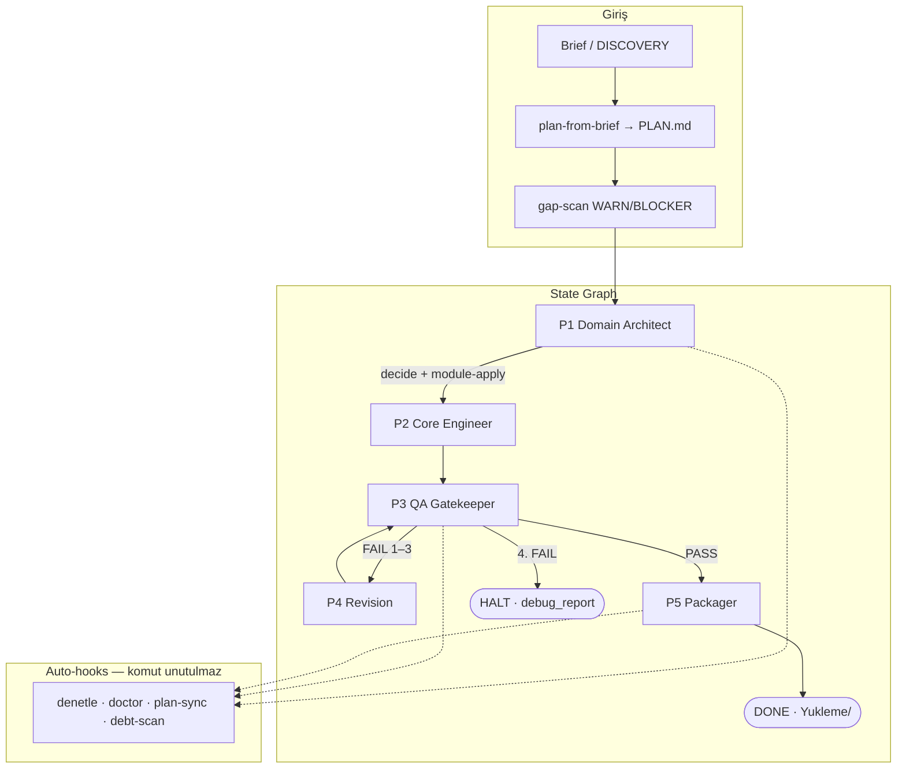

# Webrail

**Deterministik web teslim kontrol düzlemi** — çoklu AI, tek kontrat.

PHP 8.1+ MVC · MySQL 8 · HTML/CSS/JS · FTP/`Yukleme/`  
Cursor · OpenCode · Claude Code · Antigravity

| | |
|---|---|
| **System Architect** | **Ulaş Kaşıkcı** |
| Fabrika | [`github.com/UlasKasikci/repo`](https://github.com/UlasKasikci/repo) |
| Sürüm | **v1.4.1** (guardPost CSRF · SQLi taint) |
| Doğrulama | self-test **87/87** · preflight READY · 14 kanallı QA |

[](https://github.com/UlasKasikci/repo/actions/workflows/validate.yml)
[](LICENSE)
[](scripts/web/self-test.sh)
[](docs/WEB-EDITION.md)

> **Fabrika** (`webrail-factory`): `origin` → `UlasKasikci/repo`.  
> **Müşteri** (`customer-app`): fabrika remote’una bağlanmaz; `git push` varsayılan **DENY**. Dağıtım = `Yukleme/` → FTP.

---

## System Architect

**Ulaş Kaşıkcı** — Webrail mimarisi, State Graph (P1–P5), Decision Layer, Error Doctor, gap/denetle auto-hooks ve çoklu-IDE denetim anayasasının tasarımı.

---

## Mimari akış



| Faz | Ajan | Kapı / kanıt |
|-----|------|----------------|
| P1 | Domain Architect | `domain-report.json` + `decide.sh` |
| P2 / P4 | Core Engineer (+ Frontend) | MVC iskelet · `FIX-BRIEF.md` |
| P3 | QA Gatekeeper (`readonly`) | `qa-gate.sh` → **0E / 0W** |
| P5 | Deploy Packager | `packaging-report.json` → `Yukleme/` |

Tek ajan onayı yok. Kanon: [`docs/WEB-EDITION.md`](docs/WEB-EDITION.md) ·  
Arketipler: [`docs/PROJECT-ARCHETYPES.md`](docs/PROJECT-ARCHETYPES.md) · Yol haritası: [`docs/V1.4-ROADMAP.md`](docs/V1.4-ROADMAP.md)

---

## Ne çözer?

| Problem | Webrail |
|---------|---------|
| Dağınık AI süreçleri | Ortak `.factory/` state + IDE-agnostik scriptler |
| Brief’te unutulan sepet / ödeme / yorum | `gap-scan` **arketip-duyarlı** (vitrin≠mağaza) → `DENETIM.md` |
| “Yeşil görünen” güvensiz kod | 14 kanallı QA; PASS olmadan paket yok |
| Token israfı | Decision Layer + `module-apply` (katalog önce) |
| Komut zamanlamasını unutma | `orchestrate` auto-hooks (`.factory/auto-hooks.json`) |
| QA FAIL körlüğü | `doctor.sh` + **Adaptive Recovery** (imza/sınıf/strateji) |
| Kanıtsız “bitti” | **Reality Checker** (`reality-check.sh` P1/P3/P5) |
| Yanlışlıkla fabrika GitHub push | `guard.sh git-push` + `workspace-role` |

---

## Hızlı başlangıç

```bash
git clone https://github.com/UlasKasikci/repo.git ~/webrail
cd ~/webrail

composer global require phpstan/phpstan phpunit/phpunit
bash scripts/web/preflight.sh    # READY
bash scripts/web/self-test.sh    # 87/87

# Müşteri ağacı — fabrika köküne yazma
bash scripts/web/webrail.sh ../musteri-projesi --yes \
  --brief "E-ticaret: ürün katalogu, üye girişi, KVKK"
cd ../musteri-projesi
bash scripts/web/status.sh .
bash scripts/web/guard.sh matrix .
```

| Komut | Ne yapar |
|-------|----------|
| `/kesfet` · `mode from-brief` | DISCOVERY + **PLAN.md** |
| `/denetle` · `denetle.sh` | gap + debt + DENETIM (P1/P3/P5’te **otomatik**) |
| `/doktor` · `doctor.sh --loop` | QA FAIL teşhis / safe apply |
| `/web-baslat` → `/web-faz` → `/web-yukle` | P1 → P2 → P5 |

Çıkış kodları: `0` OK · `1` FAIL · `2` HALT · `3` bekleme (LLM).

Müşteri protokolü: [`docs/CUSTOMER-START.md`](docs/CUSTOMER-START.md)

---

## Depo haritası

```text
webrail/                          # fabrika = UlasKasikci/repo
├── .cursor/ · .opencode/         # kurallar, ajanlar, komutlar, skills
├── .factory/
│   ├── contracts/ · modules/     # şemalar + auth/kvkk/admin/seo paketleri
│   ├── auto-hooks.json           # denetle/doctor/plan-sync zamanlayıcı
│   ├── web-state-graph.json      # P1–P5 makinesi
│   └── workspace-role*.json      # factory vs customer-app
├── scripts/web/                  # status · guard · doctor · denetle · gap-scan ·
│                                 # plan-from-brief · plan-sync · debt-scan ·
│                                 # orchestrate · qa-gate · package-yukleme …
├── docs/                         # WEB-EDITION · V1.4-ROADMAP · templates/PLAN.md
├── tests/fixtures/
├── CLAUDE.md · antigravity.yaml · .cursorrules
└── (müşteri) WEBRAIL-CUSTOMER.md · RUN-STATUS.md · PLAN.md · Yukleme/
```

---

## Güvenlik (değişmez)

- SQL: PDO prepared only  
- XSS: `htmlspecialchars(..., ENT_QUOTES, 'UTF-8')`  
- CSRF: her POST (`guardPost` / `Csrf::*`)  
- Parola: Argon2id veya Bcrypt (≥12)  
- Oturum: HttpOnly · Secure · SameSite  
- KVKK/GDPR: compliance açıkken aydınlatma + çerez rızası zorunlu  

---

## Saha kanıtı

| Sürüm | Kanıt | Özet |
|-------|-------|------|
| v1.0 | envanter-app | QA PASS, DONE |
| v1.1 | randevu-app | ~27 dk, pattern reuse |
| v1.2 | helpdesk-app | CSRF OOP · CONTRACTS sandbox |
| v1.3 | Decision + doctor + web-only | Android purge · IDE-HANDOFF |
| v1.3.1–1.3.2 | PLAN · gap · denetle · plan-sync · debt | self-test 82/82 |
| v1.3.3 | Adaptive Recovery · Reality Checker | classify-fail · 83/83 |
| v1.4.0 | gap-inject · payment/reviews · onay matrisi | self-test 85/85 |
| v1.4.1 | guardPost CSRF · ara değişken SQLi taint | self-test 87/87 |

Release: [v1.2](https://github.com/UlasKasikci/repo/releases/tag/v1.2) · [v1.3](https://github.com/UlasKasikci/repo/releases/tag/v1.3) · [v1.4.0](docs/releases/v1.4.0.md) · [v1.4.1](docs/releases/v1.4.1.md)

---

## Ortam değişkenleri

| Değişken | Rol |
|----------|-----|
| `MODEL_P1` / `MODEL_P2` / `MODEL_P4` | Faz model routing |
| `STRICT_*` | `--strict` token / duvar bütçesi |
| `QA_GATE_EXTRA` | örn. `--allow-no-cart` |
| `P2_HUMAN_ASSIST=true` | Hybrid P2 |
| `WEBRAIL_ALLOW_GIT_PUSH=1` | Yalnız açık “push” + `guard.sh git-push` ALLOW |
| `WEBRAIL_MULTI_CANDIDATE=1` | Adaptive: tekrarlayan FAIL’de 2–3 aday (varsayılan kapalı) |

---

## Katkı (yalnız fabrika)

1. Remote: `https://github.com/UlasKasikci/repo` — müşteri ağacından buraya push **yasak**  
2. Önkoşul: `preflight.sh` READY · `self-test.sh` **87/87** · `guard.sh git-push` ALLOW  
3. Push: kullanıcı komutu + `WEBRAIL_ALLOW_GIT_PUSH=1`  
4. Doküman kanıttan türer (K5)

---

## Lisans

[MIT](LICENSE) © 2026  

**System Architect: Ulaş Kaşıkcı**
